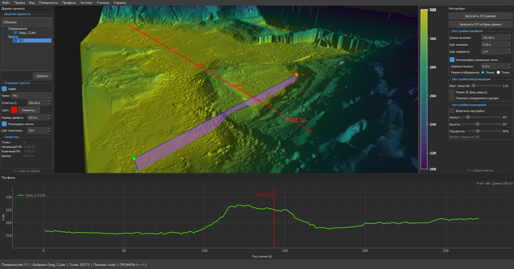
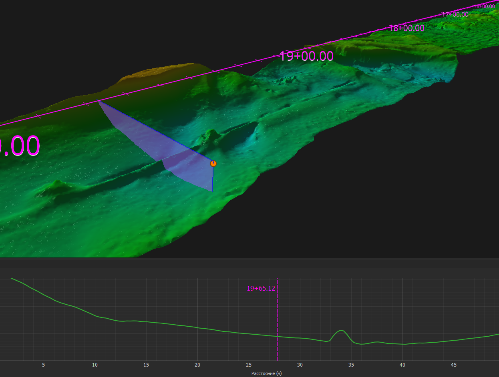

# XYZ Data Viewer

**Версия:** 0.1.88-beta  
**Автор:** Otrokov Alexander 
**Дата релиза:** 2026-10-22

**XYZ Data Viewer** - приложение для визуализации и анализа данных гидрографической и геодезической съемки.

---

## ⭐ Основные возможности

### 🗺️ Загрузка и визуализация данных

- **Поддержка множества форматов:**
  - `.xyz`, `.txt` - стандартные текстовые форматы
  - `.csv` - CSV с различными разделителями
  - `.pts`
  - `.dat`
  
- **Интерактивная 3D визуализация:**
  - OpenGL ускорение
  - Плавное вращение, панорамирование, zoom
  - Режимы 2D (план) и 3D (перспектива)
  - Работа с миллионами точек

- **Триангуляция Делоне (TIN):**
  - Автоматическое построение непрерывных поверхностей
  - Оптимальная триангуляция по алгоритму SciPy
  - Надежная интерполяция высот

- **27 цветовых палитр:**
  - Научные: viridis, cubehelix, diverging
  - Температурные: hot, fire, cool, ice, coolwarm
  - Монохромные: grays, blues, greens, reds, orange
  - Дивергентные: RdBu, RdYeBuCy, PuGr, GrBu, HiLo
  - **🆕 Инверсия любой палитры одним кликом**

### 📊 Профили и сечения

#### Классический режим (интерполяция)
- Регулярная сетка точек вдоль линии сечения
- Быстрый расчет через триангуляцию
- Подходит для общего анализа рельефа

#### 🆕 Режим реальных точек (v0.1.84)

- **Отображение ВСЕХ фактических измерений** без интерполяции
- Настраиваемая ширина полосы выборки (0.1-50 м)
- Два режима отображения:
  - **Линия** - классическое отображение профиля
  - **Точки** - scatter plot для видимости плотности
- Работает на поверхностях любого размера (включая >1M точек)
- Полная векторизация через NumPy для производительности

**Почему это важно:**
- Экспорт данных МЛЭ создает сетку точек с фиксированным шагом
- При длинных профилях (500+ м) интерполяция может терять 80% данных
- Режим реальных точек сохраняет каждую точку измерения

**Интерактивное управление:**
- Создание сечения двумя кликами мыши
- `←` / `→` - поворот сечения (±1°)
- `Shift + ←/→` - быстрый поворот (±5°)
- `↑` / `↓` - смещение вдоль перпендикуляра
- `M` - экспорт профиля в DXF

**Экспорт профилей:**
- Формат DXF для CAD систем
- Полилинии с цветовой кодировкой по поверхностям
- Вертикальные линии на пересечениях с трассами
- Автоматическая генерация имени файла с датой/временем

### 🛤️ Работа с трассами

- **Загрузка трасс** из текстовых файлов (X Y Z)
- **Автоматический расчет пикетажа:**
  - Вычисление расстояний вдоль трассы
  - Настройка референсной точки
  - Настройка начального значения пикетажа
  - Настройка интервала меток (50м, 100м, 200м и т.д.)

- **Визуализация:**
  - 3D линия трассы с настраиваемым цветом и толщиной
  - Текстовые метки пикетажа с белой обводкой
  - Метки видны через полупрозрачные поверхности

- **Редактор трассы:**
  - Интерактивный выбор референсной точки
  - Предпросмотр расчетных значений пикетажа
  - Поиск нужной точки по координатам

### 📁 Браузер базы данных (v0.1.87)

**Полноценный интерфейс для работы с локальной базой данных съёмок:**

- **Структура:**
  - Левая панель: дерево папок (как в Windows Explorer)
  - Правая верхняя: список файлов с автофильтрацией (.xyz, .txt, .pts, .csv, .dat)
  - Правая средняя: область просмотра/редактирования MD-описаний
  - Правая нижняя: кнопки управления

- **Функционал:**
  - Просмотр и редактирование описаний файлов (MD-формат)
  - Автосоздание MD-файлов при первом сохранении
  - Загрузка файлов в проект с прогресс-баром
  - Путь к БД сохраняется глобально (Windows Registry)

- **Использование:**
  - Панель "Настройки" → "Загрузить XYZ из Базы данных"
  - Выбрать папку и файл
  - Просмотреть/отредактировать описание
  - "Добавить выбранный файл в Дерево проекта"

### 🔍 Фильтрация данных МЛЭ (v0.1.87)

**Удаление артефактов на границах пустот:**

- Автоматическое удаление больших треугольников
- Медианный фильтр (порог × 5.0)
- Применяется к визуализации и профилям
- Индивидуальное включение для каждой поверхности
- Чекбокс "Фильтровать крайние треугольники"

### 📐 Импорт DXF

- **Поддержка объектов DXF:**
  - LWPOLYLINE - легковесные полилинии
  - POLYLINE - обычные полилинии
  - TEXT - текстовые объекты
  - MTEXT - многострочный текст

- **Визуализация в 3D:**
  - Отображение линий с настройкой цвета
  - Отображение текстов с белой обводкой
  - Настройка Z-смещения для всего DXF
  - Видимость через прозрачные поверхности

### 💾 Проекты и автосохранение

- **Формат проекта:** `.xdv` (JSON)
- **Сохраняет все данные:**
  - Список поверхностей с настройками визуализации
  - Трассы с параметрами пикетажа
  - DXF файлы
  - Позицию и ориентацию камеры
  - Настройки профиля (режим реальных точек, ширина полосы)

- **Автосохранение:**
  - Интервал: 5 минут (настраивается)
  - Файл: `имя_проекта.xdv.autosave`
  - Автоматическое восстановление при сбое

- **Обработка отсутствующих файлов:**
  - Диалог с выбором действий
  - Указание нового пути к файлу
  - Пропуск файла или отмена загрузки

### 🎨 Настройки визуализации

**Для поверхностей:**
- Видимость (вкл/выкл)
- Выбор палитры (27 вариантов)
- 🆕 Инверсия палитры
- Прозрачность (0-100%)
- Размер точек (1-10)
- Вертикальный масштаб (vscale: 1x-20x)

**Для трасс:**
- Видимость
- Цвет линии (RGB)
- Толщина линии (1-10)
- Показать/скрыть пикетаж
- Интервал меток
- Настройки референсной точки

**Для DXF:**
- Видимость
- Цвет по умолчанию
- Z-смещение

### 🎯 Цветовая шкала (ColorBar)

- **Вертикальный градиент** цветов активной палитры
- **Автоматические отметки высот:**
  - Целевое количество: 10 отметок (увеличено с 6)
  - "Красивые" значения (10, 20, 50, 100...)
  - Адаптация к диапазону данных
- **🆕 Синхронная инверсия** с палитрой поверхности
- Отображение минимального и максимального значений

### 🚀 Производительность

**Многопоточная обработка:**
- Фоновая загрузка файлов с прогресс-баром
- Асинхронная триангуляция больших данных
- Асинхронный расчет профилей (для поверхностей >50k точек)
- Асинхронное обновление визуализации (для поверхностей >100k точек)

**Оптимизации:**
- Векторизация через NumPy
- Кэширование цветов палитры
- In-place операции для экономии памяти
- Условное обновление (только измененные данные)

**Precomputation (опционально):**
- Регулярная сетка Z - быстрые профили (~10-50 МБ памяти)
- Прогрев кэшей - минимум памяти
- ⚠️ В текущей версии работает нестабильно

---

## 🆕 Что нового в версии 0.1.88-beta

### Новые возможности

**🚰 Визуализация трубопроводов**
- 3D-цилиндр трубы с диаметром, цветом и прозрачностью
- Отображение на профиле сечения: заливка, контур или оба варианта
- Привязка к родительской трассе: пикетаж + смещение (вправо/влево)
- Редактор трубы: таблица «Пикет | X | Y | Z | Смещение», форматы .pip/.txt
- Кнопки «Расчет ПК по XY», «Расчет XY по ПК», «Перестроить»

**📐 Вертикальный масштаб профиля (Exag)**
- Режимы «Авто» и «Вручную», множитель 1x–100x в выпадающем списке
- Индикатор фактического соотношения масштабов в шапке профиля

**🎛️ Индивидуальные настройки профиля для каждой поверхности**
- «Использовать реальные точки», ширина полосы, режим «Линия/Точки» — у каждой свои
- Сохраняются в проекте `.xdv` и в автосохранении

**🔄 Автоматическая проверка обновлений**
- Настройки → Общие настройки → «Проверка обновлений»
- Периодичность (день/неделя/месяц), час и часовой пояс
- Проверка идёт в фоне; при наличии новой версии — ненавязчивое уведомление
  в правом нижнем углу (не перехватывает фокус) с переходом к
  «Справка → Проверка обновлений»
- При отсутствии обновлений уведомления нет

**ℹ️ Диалог «О программе»**
- QR-коды Telegram и MAX (кликабельные)
- Кнопка «Проверить на наличие новой версии»

### Улучшения интерфейса

**Панели и компоновка:**
- Блок «Текущая поверхность» разделён на подгруппы «Plan» и «Profile»
- Перегруппирован блок Exag: соотношение масштабов / Авто-Вручную / множитель
- Отдельная док-панель «Свойства»
- Полное сохранение и восстановление всех настроек дока «Настройки» в проекте
- Заголовок окна показывает имя проекта с расширением (`… — 11.xdv`)

**Стабильность и отзывчивость:**
- Сериализация `Delaunay.find_simplex` глобальным локом — нет гонки Qhull
- Strong-ссылки на потоки расчёта профиля до их реального завершения
- Горячие пути логирования переведены на DEBUG (журнал не растёт лавиной)

### Критичные исправления

**🔴 Устранён класс «тихих» вылетов**
- `sip` уничтожал ещё работающий `QThread` расчёта профиля — пара `(thread, worker)`
  удерживается strong-ссылками до реального завершения потока
- Гонка `Delaunay.find_simplex` в нескольких потоках — все вызовы сериализованы
  глобальным `DELAUNAY_LOCK`
- Реентерабельный `setYRange` внутри `sigRangeChanged` в ручном Exag — пересчёт
  вертикального масштаба стал отложенным и коалесцированным
- Удалены все `QThread.terminate()` — поток не убивается посреди нативного кода

**Стабильность профиля:**
- Окно профиля больше не «раздувается» по Y и не ломает curtain в 3D
- Зона X в окне профиля не «отскакивает» при фильтрации крайних треугольников
- Рамка сечения и заливка не исчезают при догрузке поверхности в режиме профиля
- Отметки труб на профиле больше не зависят от вертикального масштаба 3D-окна

**Трубы и пикетаж:**
- Чекбокс «Visible» скрывает трубу в 3D
- Труба отображается на профиле, устранено искажение цилиндра («песочные часы»)
- Вычисление X,Y из пикетажа учитывает `start_chainage` трассы
- Диаметр из файла проекта больше не сбрасывается на 500 мм

---

## История изменений v0.1.83 → v0.1.88

### v0.1.84-beta (29.09.2026)
- ⭐ Режим реальных точек для профиля
- 🎨 Инверсия цветовых палитр
- 📊 Улучшенная читаемость текста (×1.5 размер)
- ✅ Маркеры и рамка масштабируются с vscale

### v0.1.85-beta (02.10.2026)
- 🔧 Профилировщик производительности (FPS tracking, события)
- 📋 План оптимизации (3 фазы: CPU 5-10x, CPU 2-3x, GPU 10-100x)
- 📚 Документация docs/FUTURE/02_optimization.md (1200+ строк)

### v0.1.86-beta (06.10.2026)
- 📐 Реорганизация панелей (логичный порядок групп)
- 🧹 Упрощение интерфейса (убрано дублирование)
- 🪟 Плавающая панель координат
- 🔧 Свободное изменение размеров док-панелей
- ⚡ Устранено мерцание кнопок, очищены логи

### v0.1.87-beta (13.10.2026)
- 📁 Браузер локальной базы данных съёмок (MD-описания, загрузка в проект)
- 🔍 Фильтрация крайних треугольников для МЛЭ
- 💾 Глобальное сохранение пути к БД (QSettings)
- 🔴 Исправлена прозрачность рамки профиля (двойное деление на 100)

### v0.1.88-beta (22.10.2026)
- 🚰 Визуализация трубопроводов (3D + профиль), редактор трубы с расчётом ПК↔XY
- 📐 Exag 1x–100x для окна профиля (Авто/Вручную)
- 🎛️ Индивидуальные настройки профиля для каждой поверхности
- 🔄 Автоматическая проверка обновлений с уведомлением
- 🔧 Полное сохранение/восстановление настроек дока в проекте
- 🛡️ Устранён класс «тихих» вылетов (QThread/sip, гонка Delaunay, Exag)

---

## 💻 Установка

### Системные требования

- **ОС:** Windows 10/11 (64-bit)
- **ОЗУ:** минимум 4 ГБ, рекомендуется 8+ ГБ
- **OpenGL:** версия 3.3+
- **Место на диске:** ~500 МБ

### Установка из инсталлятора

1. Скачайте `XYZ_DataViewer_Setup_0.1.88-beta.exe`
2. Запустите инсталлятор
3. Следуйте инструкциям мастера установки
4. Запустите приложение через ярлык на рабочем столе

---

## 📚 Быстрый старт

### Первые шаги

1. **Загрузите данные:**
   - `Ctrl+O` → выберите XYZ файл
   - Дождитесь триангуляции
   - Данные отобразятся в 3D

2. **Настройте визуализацию:**
   - Выберите палитру в панели проекта
   - Измените прозрачность при необходимости
   - Настройте вертикальный масштаб (vscale)

3. **Создайте профиль:**
   - Нажмите `P` для активации режима профиля
   - Кликните дважды мышью для задания линии сечения
   - Профиль отобразится в нижнем окне

4. **Настройте профиль:**
   - Включите "Использовать реальные точки" для точности
   - Настройте ширину полосы (обычно 0.5-1 м)
   - Выберите режим отображения (Линия/Точки)

5. **Управляйте сечением:**
   - `←/→` - поворот (±1°)
   - `Shift+←/→` - быстрый поворот (±5°)
   - `↑/↓` - смещение
   - `M` - экспорт в DXF

6. **Сохраните проект:**
   - `Ctrl+S` → укажите имя файла
   - Все настройки сохранятся в .xdv

### Работа с данными МЛЭ

**Оптимальные настройки:**
- Режим профиля: **Использовать реальные точки** ✅
- Ширина полосы: **1-2 метра**
- Режим отображения: **Точки** (scatter)
- Палитра: viridis или coolwarm
- vscale: 2-3x

**Результат:**
- Видны ВСЕ точки измерений
- Плотность покрытия очевидна
- Нет потери информации
- Реальные расстояния между точками

---

## ⌨️ Горячие клавиши

### Файлы и проекты

| Клавиша | Действие |
|---------|----------|
| `Ctrl+O` | Загрузить XYZ файл |
| `Ctrl+T` | Загрузить трассу |
| `Ctrl+D` | Загрузить DXF |
| `Ctrl+S` | Сохранить проект |
| `Ctrl+Shift+S` | Сохранить как... |

### Режим профиля

| Клавиша | Действие |
|---------|----------|
| `P` | Включить режим профиля |
| `Esc` | Выключить режим профиля |
| `←` / `→` | Повернуть сечение (±1°) |
| `Shift+←/→` | Быстрый поворот (±5°) |
| `↑` / `↓` | Сместить сечение вдоль перпендикуляра |
| `M` | Экспорт профиля в DXF |

### Навигация

| Действие | Управление |
|----------|------------|
| Вращение (3D) | Левая кнопка мыши + движение |
| Панорамирование | Правая кнопка мыши + движение |
| Zoom | Колесо мыши |
| Центрирование | Средняя кнопка мыши на точке |

---

### Ограничения

1. **Размер данных:**
   - Рекомендуемый максимум: 5-10 млн точек
   - Зависит от доступной ОЗУ

2. **Precomputation:**
   - Режимы работают нестабильно
   - Могут вызывать зависания

3. **DXF экспорт:**
   - Только профили (не поверхности)
   - Ограниченная поддержка стилей

### Устранение неполадок

**Медленная триангуляция:**
- Прорежьте данные или используйте меньший файл

**Приложение зависает:**
- Отключите precomputation режимы в настройках

**Артефакты визуализации:**
- Обновите драйверы GPU
- Проверьте поддержку OpenGL 3.3+

**Некорректный профиль:**
- Проверьте настройки режима реальных точек
- Убедитесь, что ширина полосы адекватна данным

**GitHub:** https://github.com/alexsevas/XYZ-data-viewer

---

© 2026 Otrokov Alexander. 

---

## 📞 Контакты

- **Автор:** Otrokov Alexander
- **GitHub:** https://github.com/alexsevas
- **TG:** https://t.me/alexsevas
- **Email:** a1exsevas@yandex.ru

---

**Дата последнего обновления:** 2026-10-22  
**Статус:** Beta

